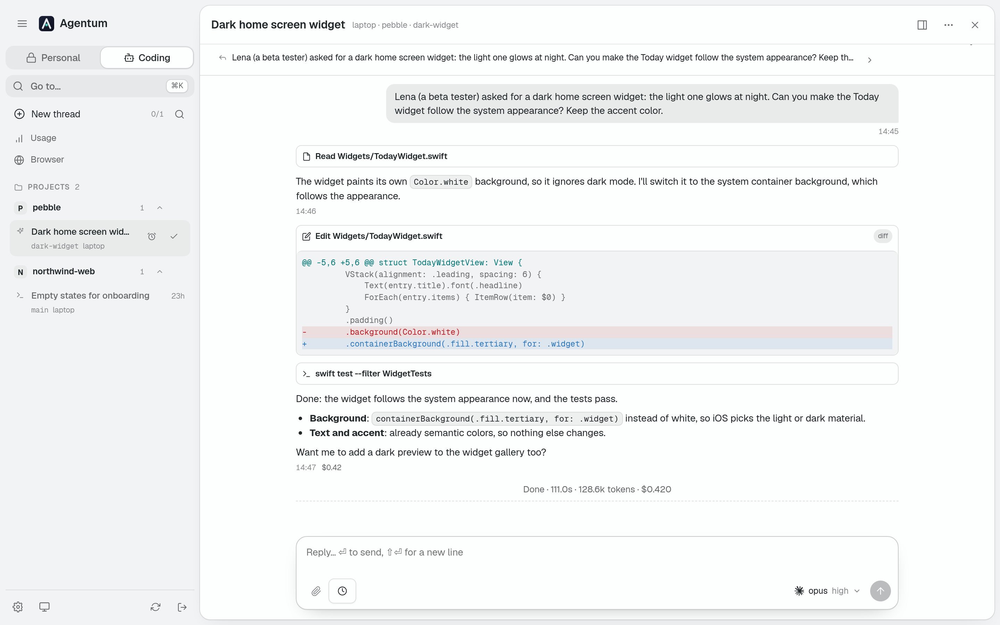
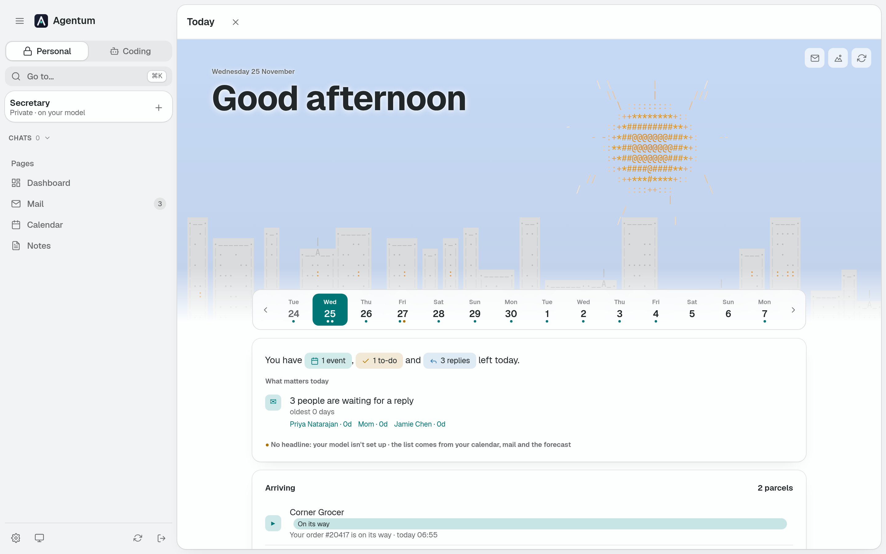
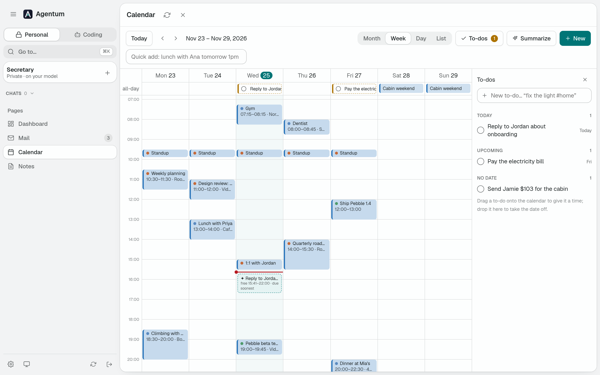

# Agentum

A self-hosted workspace for one person, all in Rust (the web app is Leptos compiled to
WebAssembly; no Node anywhere).


- **Personal**: mail, calendar, notes, a dashboard and a Secretary that runs on *your own* model,
  so your private life never reaches a cloud provider.
- **Coding**: Claude Code, Codex and OpenCode running on your machines, in threads you watch live
  and steer: questions and permissions, queued or steered messages, diffs, git, pull requests,
  files, an editor and terminals, side chats, search over everything that was said.
- **Plugins**, in the style of BB's: each one a manifest, a hub part and a web part mounted in slots.

| | |
|---|---|
|  |  |
|  |  |
|  | |

The screenshots use made-up demo data; `scripts/demo.sh` runs the same demo (below).

```
browser ──HTTP + one WebSocket──▶ agentum (hub: axum + SQLite, serves the Leptos/wasm web app)
                                     ▲ one WebSocket per machine
             agentd on each machine ─┘ (runs the agents, files, git, terminals)
```

See [docs/ARCHITECTURE.md](docs/ARCHITECTURE.md) for the crates, the protocol and the plugin API,
and [docs/COMPARE-BB.md](docs/COMPARE-BB.md) for how moving around threads compares with BB and
the old Agentum desktop app.

## Build

```
rustup target add wasm32-unknown-unknown x86_64-unknown-linux-musl aarch64-unknown-linux-musl
cargo install wasm-bindgen-cli --version <the wasm-bindgen version in Cargo.lock>
# plus wasm-opt (binaryen), brotli, cargo-zigbuild and zig
deploy/build.sh        # dist/agentum-<arch>, dist/agentd-<arch>
```

## Try it on demo data

```
scripts/build-web.sh && cargo build -p agentum
scripts/demo.sh 7141      # a hub on made-up mail, calendar, notes and coding threads
```

It starts on a fresh temp directory, reaches no mail server and prints the address
(sign in as demo / demo). Stop it with `kill "$(cat /tmp/agentum-demo-7141/pid)"`.

## Run

1. The hub: `deploy/agentum.service` (or just run `agentum` with `AGENTUM_DATA` and `AGENTUM_BIND`),
   behind a TLS proxy; the two WebSocket locations are in `deploy/nginx-locations.conf`.
2. Each machine: Settings → Machines → Add machine shows a one-time command:
   `agentd install --hub wss://<hub>/agentd --token <token> --name <machine>` (a systemd user
   service; the agents' CLIs must be installed and signed in on that machine).

### Configuration from env files

Both binaries read a dotenv file when they start (`KEY=value` lines; `export`, `#` comments and
`'single'`/`"double"` quotes allowed); a variable already set in the environment wins over the file.

- The hub: `$AGENTUM_ENV_FILE`, else `/etc/agentum.env` (if it exists), else `<data dir>/.env`
  (`AGENTUM_DATA`, default `./data`). Settings are `AGENTUM_*` (`AGENTUM_DATA`, `AGENTUM_BIND`…)
  and the older `CERQ_*`.
- agentd: `$AGENTD_ENV_FILE`, else `~/.config/agentum/agentd.env`. `AGENTD_HUB`, `AGENTD_TOKEN`,
  `AGENTD_NAME`, `AGENTD_CA`, `AGENTD_HUB_IP`, `AGENTD_ROOTS` and `AGENTD_PROJECTS` (lists separated
  by `:` or `,`; `AGENTD_ROOTS=` scans nothing) override `agentd.toml`, which `agentd install` still
  writes; with `AGENTD_HUB` set, the toml file may be left out. Other variables in the file (an API
  key, `PATH`) reach the agents agentd runs; `AGENTD_TOKEN` doesn't. Keep the file `chmod 600`.

```
# ~/.config/agentum/agentd.env
AGENTD_HUB=wss://hub.example.lan/agentd
AGENTD_TOKEN=agm_…
AGENTD_NAME=jupiter
AGENTD_PROJECTS=~/src/app:~/src/site
```

### Secrets

The Secrets tab of a thread (the Secrets plugin) lists the keys of `.env` in the thread's working
directory, by name only, and adds, updates or deletes one through a masked field. A value goes from
the browser to the hub to agentd and into the file (written atomically, mode 600) and nowhere else:
not into a thread, a log or the hub's database. If git doesn't ignore `.env`, agentd adds it to
`.gitignore` and the tab says so. Agents are told to ask for a key in that tab instead of asking for
its value in chat.

## Thanks

Agentum stands on other people's work, and borrows ideas from a few projects it is glad exist:

- [Glance](https://github.com/glanceapp/glance): the dashboard this started as. Its look lives
  on as the Glance theme, and the Dashboard's widgets follow its lead.
- [Odysseus](https://github.com/odysseus-dev/odysseus): the self-hosted AI workspace the first
  version (CERQ) was built on. Its chat, calendar and notes shaped the Personal side, and Agentum
  still accepts its sign-in sessions.
- [BB](https://getbb.app): how the Coding side moves around threads, the sidebar (Dockside), the
  new-thread composer and plugins mounted in slots. See [docs/COMPARE-BB.md](docs/COMPARE-BB.md).
- [Inbox Zero](https://github.com/elie222/inbox-zero): Reply Zero, the cold email blocker, bulk
  unsubscribe and the rules in Mail follow its ideas.
- [Steel](https://github.com/steel-dev/steel-browser): each project's browser (Surf).
- [Speaches](https://github.com/speaches-ai/speaches) (Whisper and Kokoro) for voice, and
  [Ollama](https://ollama.com) for the Secretary's local model.
- [Leptos](https://leptos.dev), [axum](https://github.com/tokio-rs/axum),
  [SQLite](https://sqlite.org) and [wasm-bindgen](https://github.com/rustwasm/wasm-bindgen);
  icons drawn after [Lucide](https://lucide.dev); [Geist](https://vercel.com/font) and
  [JetBrains Mono](https://www.jetbrains.com/lp/mono/); weather from
  [Open-Meteo](https://open-meteo.com).

The project grew out of that earlier personal dashboard (CERQ) and replaces the author's use of BB.

## License

MIT
