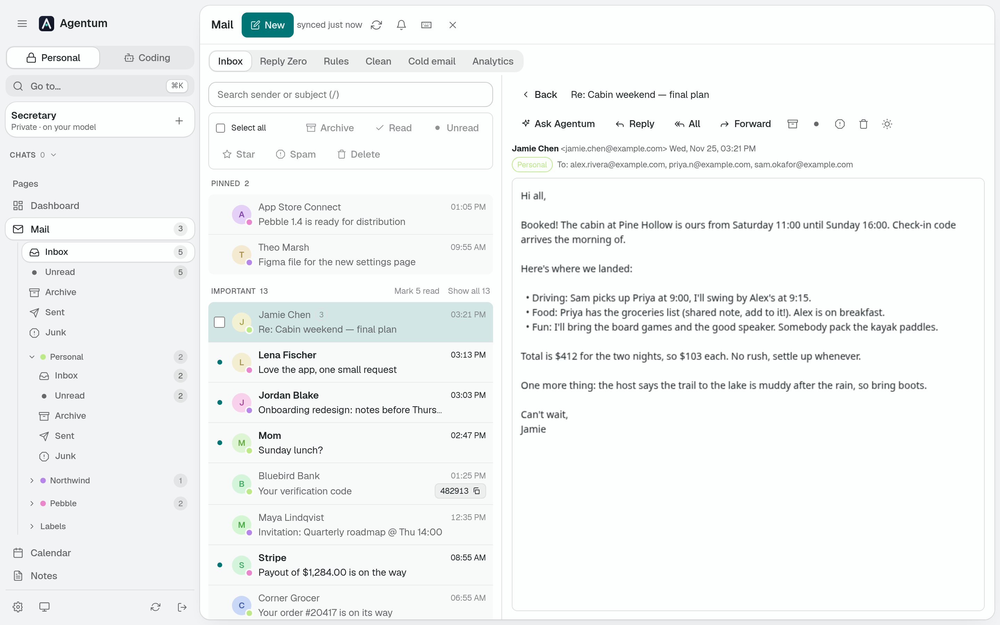
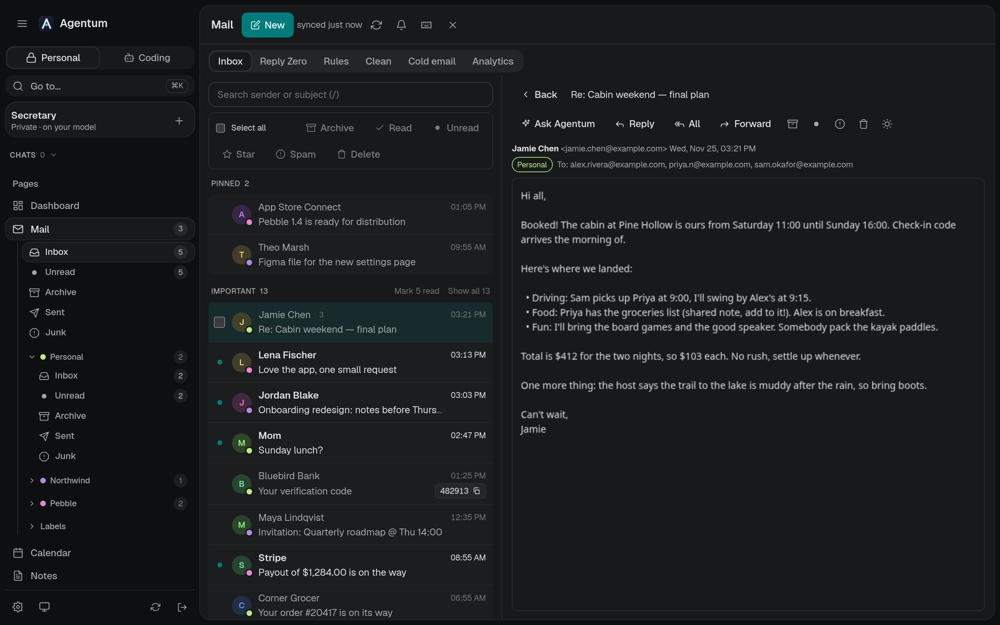
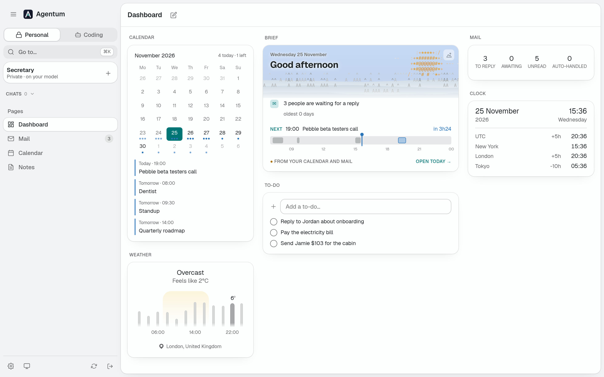

# Agentum

**Your mail, calendar and notes, and your coding agents, in one self-hosted app.**

Agentum runs on a small server you own (a Raspberry Pi is enough) and puts two things side by
side: a private **Personal** space with an assistant that runs on your own model, and a **Coding**
space where Claude Code, Codex, OpenCode and Cursor work on your machines while you watch and steer.
It is all Rust: the server, the agent daemon, and the web app (Leptos compiled to WebAssembly).



## What's inside

**Personal**
- **Mail** for several accounts (IMAP, Google and Microsoft sign-in): one inbox grouped into what
  matters, the folders in the app's sidebar, a reading pane that follows light and dark, Reply Zero,
  rules, bulk cleanup and push notifications.
- **Calendar** over iCloud, Google and Outlook: month, week, day and list views, recurring events,
  and to-dos beside the grid.
- **Notes and to-dos**, a **Today** page that plans your day, and a **Dashboard** of widgets.
- **The Secretary**: a private chat on *your own* model (Ollama), with voice, that can look across
  your mail, calendar and notes. Your private life never reaches a cloud provider.

**Coding**
- Threads for **Claude Code, Codex, OpenCode and Cursor** on any machine running `agentd`. Watch
  them live, answer their questions and permissions, queue or steer messages, and stop a turn.
- Each thread has diffs, git, pull requests, files, an editor, terminals, side chats, scheduled
  messages, a per-project browser (Surf) and a Secrets tab for `.env` keys.
- New threads in the project checkout or a fresh worktree, a sidebar that sorts what needs you,
  each agent's subscription usage, and ⌘K to search everything that was said.

**All in one**: any page opens in either half of the screen, so Mail can sit beside a coding
thread, with its folders in the sidebar.

**Plugins**: every tool around a thread is a plugin, a manifest plus a server part and a web part
mounted in slots. 23 ship in [`plugins/`](plugins).

## Screenshots

| | |
|---|---|
|  |  |
| **Coding**: a thread with its tool calls and diff | **Mail**, dark |
|  |  |
| **Today**: the day at a glance | **Calendar**: the week, with to-dos |
|  | |
| **Dashboard** | |

Every screenshot uses made-up demo data; [`scripts/demo.sh`](scripts/demo.sh) runs the same demo.

## How it works

```
browser ──HTTP + one WebSocket──▶ agentum   the hub: axum + SQLite; serves the web app,
                                     ▲       syncs mail and calendars, keeps every thread
                                     │ one WebSocket per machine
          agentd on each machine ────┘       runs the agents, files, git and terminals
```

- **`agentum`**, the hub: one binary with the web app embedded. It keeps your data in SQLite.
- **`agentd`**, on every machine that should run agents: it connects out to the hub, so the
  machines need no open ports.
- **The web app**: Leptos in the browser (about 1.2 MB compressed), installable as a home-screen
  app with push notifications.

More in [docs/ARCHITECTURE.md](docs/ARCHITECTURE.md) (the crates, the protocol, the plugin API) and
[docs/COMPARE-BB.md](docs/COMPARE-BB.md) (how moving around threads compares with BB).

## Try it

With the Rust toolchain, the `wasm32-unknown-unknown` target, `wasm-bindgen-cli` and `wasm-opt`
installed (see [Build](#build)):

```sh
scripts/build-web.sh && cargo build -p agentum
scripts/demo.sh 7141      # a hub on made-up mail, calendar, notes and coding threads
```

It starts on a fresh temp directory, reaches no mail server, and prints the address. Sign in as
`demo` / `demo`, and stop it with `kill "$(cat /tmp/agentum-demo-7141/pid)"`.

## Build

```sh
rustup target add wasm32-unknown-unknown x86_64-unknown-linux-musl aarch64-unknown-linux-musl
cargo install wasm-bindgen-cli --version <the wasm-bindgen version in Cargo.lock>
# plus wasm-opt (binaryen), brotli, cargo-zigbuild and zig
deploy/build.sh        # dist/agentum-<arch>, dist/agentd-<arch>
```

## Run

1. **The hub**: install `deploy/agentum.service` (or run `agentum` with `AGENTUM_DATA` and
   `AGENTUM_BIND`) behind a TLS proxy. The two WebSocket locations the proxy needs are in
   `deploy/nginx-locations.conf`.
2. **Each machine**: Settings → Machines → Add machine shows a one-time command,
   `agentd install --hub wss://<hub>/agentd --token <token> --name <machine>`. It installs a
   systemd user service. The agents' CLIs must be installed and signed in on that machine.

### Configuration

Both binaries read a dotenv file at start (`KEY=value` lines; `export`, `#` comments and quotes
allowed). A variable already set in the environment wins over the file.

- **The hub** reads `$AGENTUM_ENV_FILE`, else `/etc/agentum.env` if it exists, else
  `<data dir>/.env` (`AGENTUM_DATA`, default `./data`). Its settings are `AGENTUM_*` and the older
  `CERQ_*`.
- **agentd** reads `$AGENTD_ENV_FILE`, else `~/.config/agentum/agentd.env`:
  - These override `agentd.toml`: `AGENTD_HUB`, `AGENTD_TOKEN`, `AGENTD_NAME`, `AGENTD_CA`,
    `AGENTD_HUB_IP`, `AGENTD_ROOTS` and `AGENTD_PROJECTS`. Lists are separated by `:` or `,`, and
    `AGENTD_ROOTS=` scans nothing.
  - `agentd install` still writes `agentd.toml`, but with `AGENTD_HUB` set it can be left out.
  - Other variables in the file (an API key, `PATH`) reach the agents; `AGENTD_TOKEN` doesn't.
  - Keep the file `chmod 600`.

```sh
# ~/.config/agentum/agentd.env
AGENTD_HUB=wss://hub.example.lan/agentd
AGENTD_TOKEN=agm_…
AGENTD_NAME=laptop
AGENTD_PROJECTS=~/src/app:~/src/site
```

### Secrets

A thread's **Secrets** tab lists the keys in the `.env` of its working directory, by name only.
You add, change or delete a key through a masked field.

- **Where a value goes:** from the browser to the hub to agentd and into the file (written
  atomically, mode 600). It never lands in a thread, a log or the hub's database.
- **`.gitignore`:** if git doesn't ignore `.env`, agentd adds it to `.gitignore` and the tab says so.
- **Agents:** they're told to ask for a key in that tab instead of asking for its value in chat.

## Thanks

Agentum stands on other people's work, and borrows ideas from projects it is glad exist:

- [Glance](https://github.com/glanceapp/glance): the dashboard this started as. Its look lives on
  as the Glance theme, and the Dashboard's widgets follow its lead.
- [Odysseus](https://github.com/odysseus-dev/odysseus): the self-hosted AI workspace the first
  version was built on. Its chat, calendar and notes shaped the Personal side, and Agentum still
  accepts its sign-in sessions.
- [BB](https://getbb.app): how the Coding side moves around threads, the sidebar (Dockside), the
  new-thread composer and plugins mounted in slots.
- [Steel](https://github.com/steel-dev/steel-browser): each project's browser (Surf).
- [Orca](https://github.com/stablyai/orca): the notification sounds, from when Agentum's desktop app
  was built on it.
- [Speaches](https://github.com/speaches-ai/speaches) (Whisper and Kokoro) for voice, and
  [Ollama](https://ollama.com) for the Secretary's local model.
- [Leptos](https://leptos.dev), [axum](https://github.com/tokio-rs/axum),
  [SQLite](https://sqlite.org) and [wasm-bindgen](https://github.com/rustwasm/wasm-bindgen); icons
  drawn after [Lucide](https://lucide.dev); [Geist](https://vercel.com/font) and
  [JetBrains Mono](https://www.jetbrains.com/lp/mono/); weather from
  [Open-Meteo](https://open-meteo.com).

## License

[MIT](LICENSE)
